<p align="center">
  
</p>

<h1 align="center">Yetty</h1>

<p align="center">
  Terminal e gerenciador de sessões para Windows: SSH2, SFTP, Telnet, RLogin, TCP cru, porta serial, shell local e RDP, em uma única janela com abas, painéis e scripts.
</p>

<p align="center">
  
  
  
</p>

---

## Sumário

- [Visão geral](#visão-geral)
- [Requisitos](#requisitos)
- [Compilar e executar](#compilar-e-executar)
- [Primeiros passos](#primeiros-passos)
- [Telas](#telas)
- [Funcionalidades](#funcionalidades)
  - [Protocolos e conexões](#protocolos-e-conexões)
  - [Gerenciador de sessões](#gerenciador-de-sessões)
  - [Abas, painéis e layout](#abas-painéis-e-layout)
  - [Emulação de terminal e aparência](#emulação-de-terminal-e-aparência)
  - [Transferência de arquivos](#transferência-de-arquivos)
  - [Scripts e gravação](#scripts-e-gravação)
  - [Janela de comandos e Command Manager](#janela-de-comandos-e-command-manager)
  - [Chaves SSH e credenciais](#chaves-ssh-e-credenciais)
  - [Log, impressão e snapshots](#log-impressão-e-snapshots)
  - [Mapa de teclas](#mapa-de-teclas)
- [Atalhos principais](#atalhos-principais)
- [Configurações e dados](#configurações-e-dados)
- [Limitações conhecidas](#limitações-conhecidas)
- [Documentação de implementação](#documentação-de-implementação)
- [Licença](#licença)

---

## Visão geral

O Yetty reúne em uma só janela os clientes de terminal que normalmente ficam espalhados pelo Windows. Cada conexão é uma **sessão** salva em um gerenciador com pastas, e cada sessão aberta vira uma **aba** ou um **painel**. O programa é escrito em Rust, com a interface em [egui](https://github.com/emilk/egui) (via `eframe`) e emulação de terminal com `vt100`.

Pontos de design:

- **Usa as ferramentas do próprio Windows.** SSH e SFTP chamam o `ssh.exe` e o `sftp.exe` do OpenSSH instalado no sistema; o shell local usa ConPTY; RDP abre o `mstsc.exe`.
- **Senhas salvas são cifradas com DPAPI**, ligadas ao usuário do Windows que as salvou.
- **Configurações em um único `settings.json`**, sem registro e sem instalador.

---

## Requisitos

| Item | Detalhe |
|---|---|
| Sistema | Windows 10 ou 11 (x64) |
| Cliente SSH | OpenSSH client do Windows (`ssh.exe`, `sftp.exe`, `ssh-keygen.exe`, `ssh-add.exe`). Vem como recurso opcional do Windows. |
| Git for Windows | Opcional. Recomendado se você usa SFTP com permissões de arquivo completas. |
| Compilação | Toolchain Rust estável com target MSVC (`x86_64-pc-windows-msvc`). |
| Serial | Porta COM física ou virtual. |

---

## Compilar e executar

```bash
# Desenvolvimento
cargo run

# Versão otimizada
cargo build --release
# o executável fica em target/release/yetty.exe
```

---

## Primeiros passos

1. Abra o Yetty. A janela inicial aparece vazia, com o painel **Session Manager** à esquerda.
2. Para uma conexão rápida, use **File > Quick Connect** (`Alt+Q`), escolha o protocolo, informe o host e clique em **Connect**.
3. Para salvar a conexão, marque **Save session** antes de conectar, ou crie a sessão em **File > New Session** (assistente).
4. Para um shell local, use **File > Local Shell** (`Alt+Shift+L`).

<p align="center">
  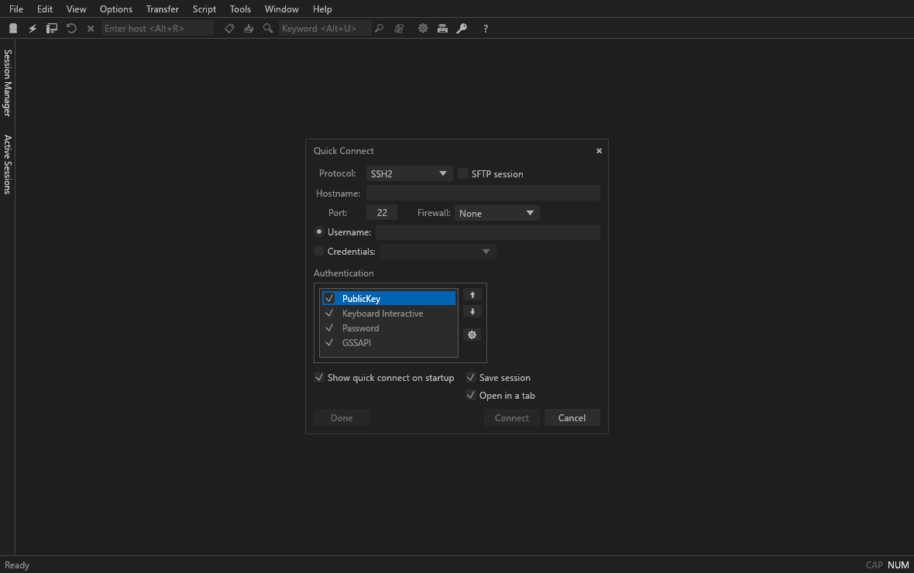
  <br>
  <em>Janela inicial: menus, barra de ferramentas, painéis laterais e a área de abas vazia.</em>
</p>

---

## Telas

As capturas abaixo são renderizações reais da interface com dados de exemplo.

### Quick Connect

Diálogo de conexão rápida. O protocolo muda os campos exibidos: para SSH2 aparecem firewall, usuário, credenciais e a ordem dos métodos de autenticação (PublicKey, Keyboard Interactive, Password, GSSAPI).

<p align="center">
  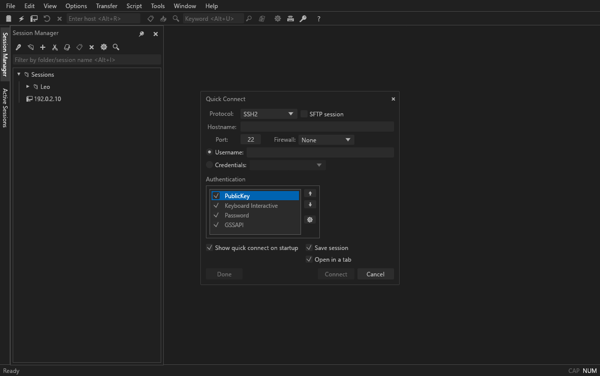
</p>

- **Protocol**: SSH2, Telnet, Telnet/TLS, Local Shell, RDP, Serial, RLogin ou Raw.
- **Show quick connect on startup**: abre este diálogo sempre que o Yetty iniciar.
- **Save session**: grava a conexão no Session Manager.
- **Open in a tab**: abre a sessão em nova aba em vez de substituir a atual.

### Assistente de nova sessão

Guia passo a passo para criar uma sessão salva. Pode ser desativado com a opção "Do not use this wizard when creating sessions".

<p align="center">
  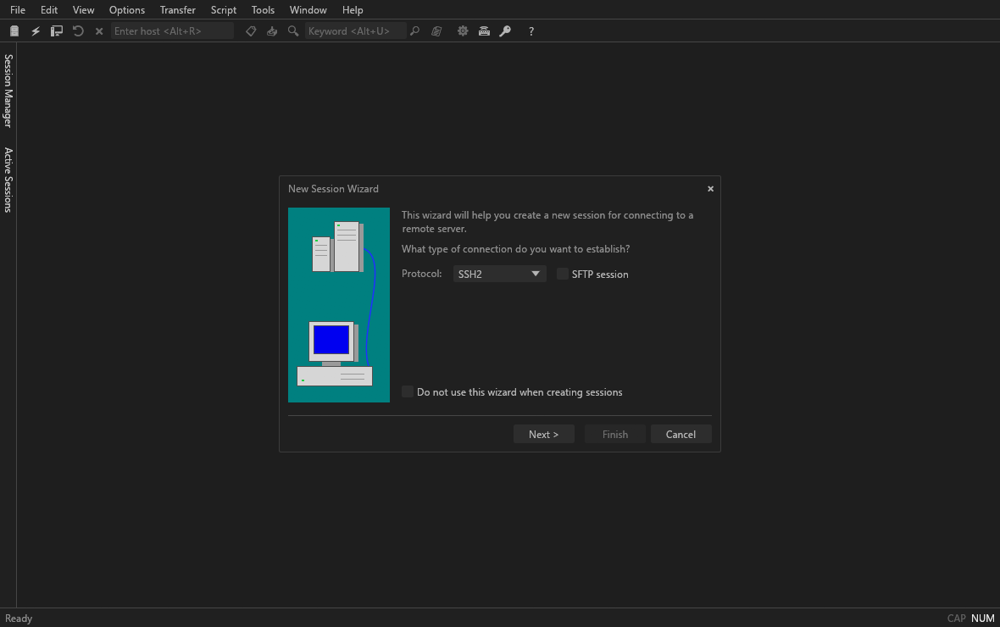
</p>

### Terminal

Sessão de shell local com cores ANSI, caracteres CJK e símbolos. A barra de status mostra o tipo da sessão, a posição do cursor (linha, coluna), o tamanho (linhas e colunas), o modo de emulação (Xterm) e os indicadores CAP e NUM.

<p align="center">
  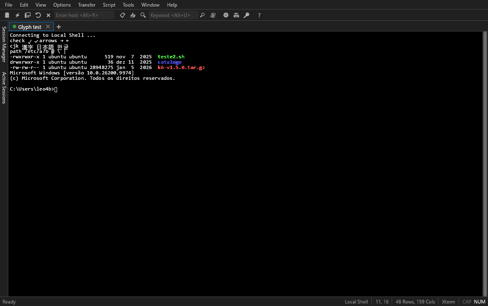
</p>

### Confirmação de colagem multilinha

Ao colar um texto com mais de uma linha no terminal, o Yetty mostra o conteúdo antes de enviar. Evita executar comandos por engano. Você pode ocultar o diálogo ("Do not show this dialog again") e ajustar o atraso entre linhas ("Override line send delay", padrão 5 ms).

<p align="center">
  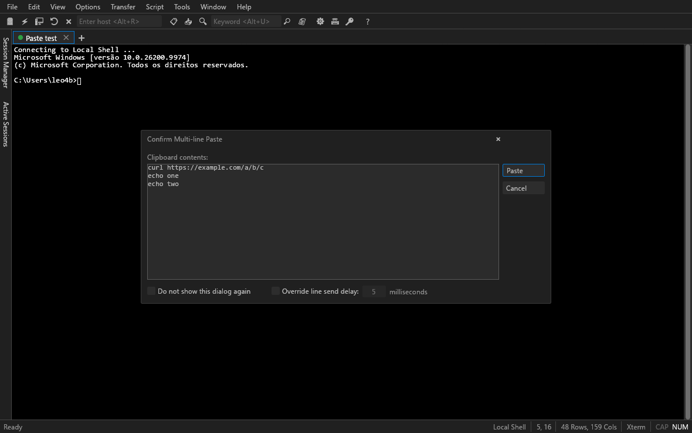
</p>

### Senha SSH

Quando o servidor pede senha, o Yetty pergunta antes de conectar. Marque **Save password** para guardá-la cifrada com DPAPI. **Skip** segue sem senha, para tentar outro método de autenticação.

<p align="center">
  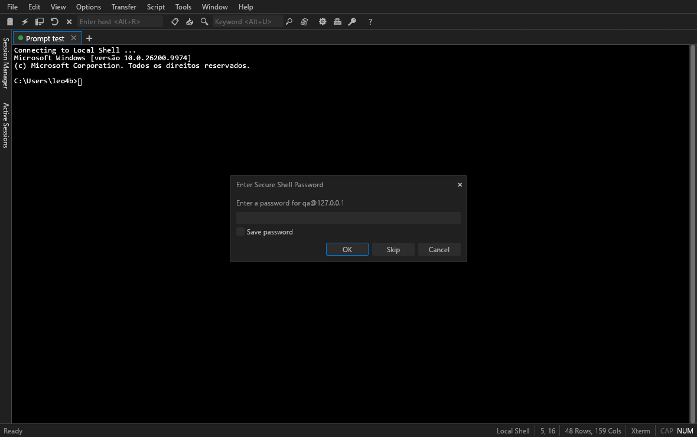
</p>

### Verificação de chave de host

Na primeira conexão a um servidor, o Yetty mostra a impressão digital SHA256 da chave do host. Use **View Host Key** para inspecionar, **Accept & Save** para confiar e gravar, ou **Cancel** para abortar.

<p align="center">
  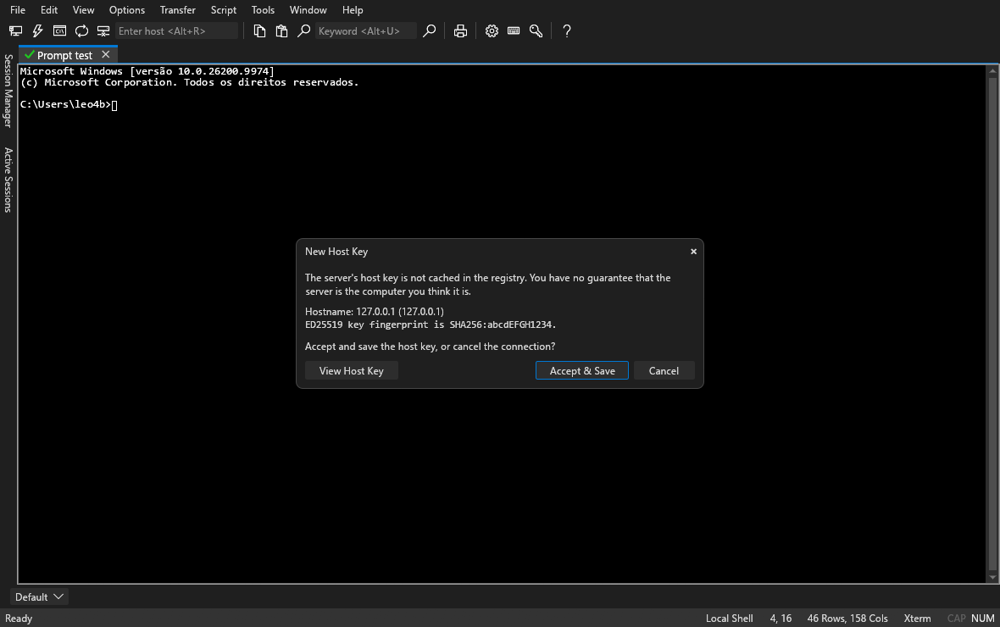
</p>

### Janela de comandos

Painel inferior para enviar um mesmo texto à sessão ativa, ou ao grupo de abas selecionado. Ideal para repetir comandos sem trocar de aba.

<p align="center">
  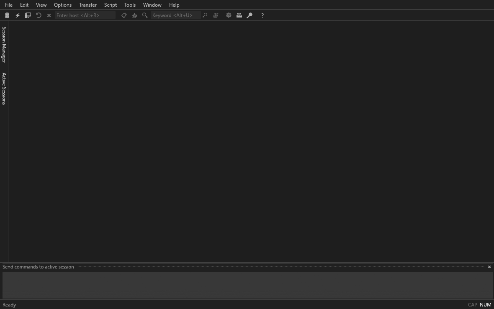
</p>

### Command Manager

Biblioteca de comandos organizada em pastas, com filtro (`Alt+Y`). Cada item executa uma ação ao ser clicado.

<p align="center">
  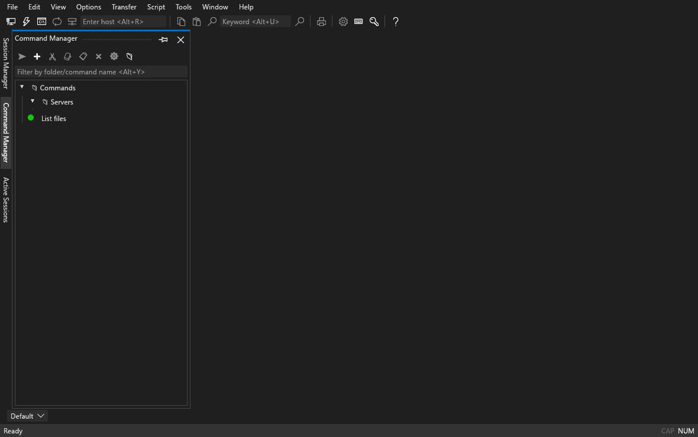
</p>

### Propriedades do comando

Define a ação do comando: **Function** (por exemplo, Send String), o texto enviado, rótulo, cor do ícone e descrição. A caixa mostra a lista de sequências especiais aceitas.

<p align="center">
  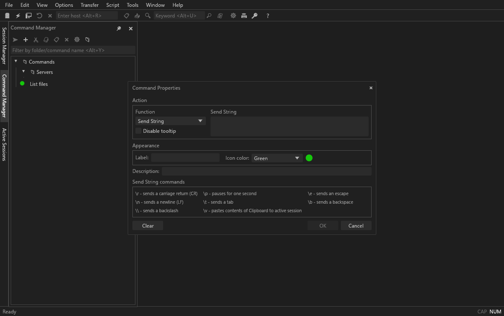
</p>

Sequências aceitas em **Send String**:

| Sequência | Efeito |
|---|---|
| `\r` | Retorno de carro (CR) |
| `\n` | Nova linha (LF) |
| `\t` | Tabulação |
| `\e` | Escape |
| `\b` | Backspace |
| `\\` | Barra invertida literal |
| `\p` | Pausa de um segundo |

### Layout lado a lado

Modo **Tile Vertically**: duas sessões ocupam o espaço lado a lado, e cada uma continua independente.

<p align="center">
  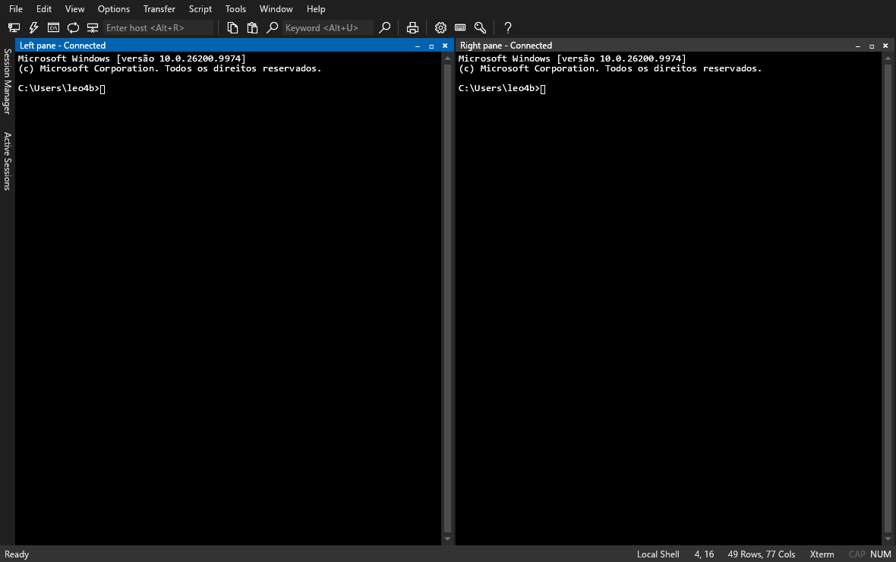
</p>

### Grupos de abas

Abas podem ser agrupadas. Um grupo recebe comandos da janela de comandos ao mesmo tempo, o que permite operar vários servidores com um único envio.

<p align="center">
  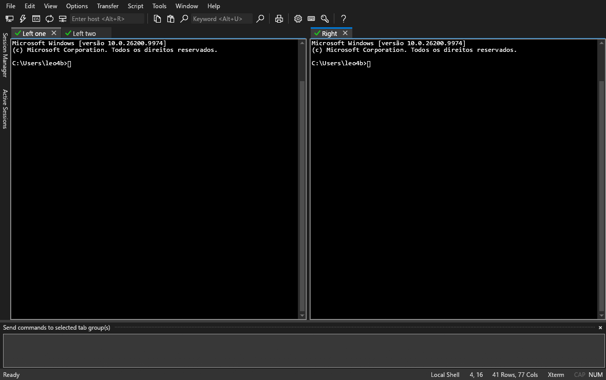
</p>

### Opções globais

Árvore de configurações com páginas para caminhos, sessão automática, credenciais, terminal, aparência, paleta ANSI, barra de status, abas, mosaico, impressão, navegador, servidor TFTP, firewall, SSH2, chaves do agente e chaves de host.

<p align="center">
  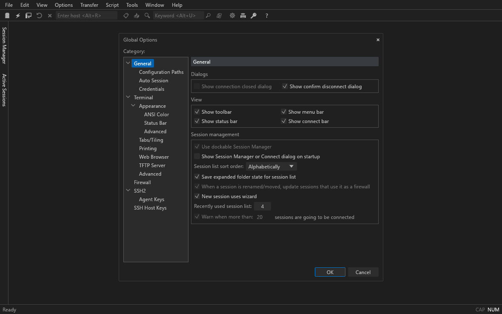
</p>

### Mapa de teclas

Editor visual de mapeamento. Você escolhe a tecla (com Ctrl, Alt e Shift) e a função, ou envia uma string. Permite salvar e carregar mapas.

<p align="center">
  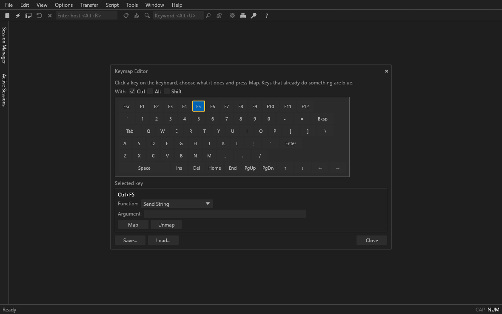
</p>

---

## Funcionalidades

### Protocolos e conexões

| Protocolo | Como funciona | Porta padrão |
|---|---|---|
| **SSH2** | Executa o `ssh.exe` do OpenSSH em uma aba. Suporta autenticação por chave pública, teclado interativo, senha e GSSAPI. | 22 |
| **SFTP** | Sessão SFTP via `sftp.exe`. Ativada pela opção "SFTP session" dentro de SSH2. | 22 |
| **Telnet** | Conexão TCP com negociação Telnet. | 23 |
| **Telnet/TLS** | Telnet sobre TLS, com SChannel (`native-tls`). | 992 |
| **RLogin** | Protocolo RLogin sobre TCP. | 513 |
| **Raw** | TCP puro, sem negociação. | 23 |
| **Serial** | Porta COM com baud, bits, paridade, stop bits e controle de fluxo. Padrão: 38400, 8N1, XON/XOFF. | — |
| **Local Shell** | Shell do Windows (PowerShell, cmd ou outro) via ConPTY. | — |
| **RDP** | Inicia o Remote Desktop (`mstsc.exe`) em janela própria. | 3389 |

Na linha de comando, o protocolo pode ser passado diretamente: `ssh`, `telnet`, `rlogin`, `raw` (ou `tcp`) e `local` (ou `shell`, `cmd`).

### Gerenciador de sessões

Painel **Session Manager** à esquerda (`Alt+M`).

- Sessões organizadas em **pastas**, com criação, renomeação, exclusão e duplicação.
- **Arrastar e soltar** para mover sessões entre pastas.
- **Filtro** por nome ou host (`Alt+I`).
- Duplo clique conecta. `F2` renomeia, `Del` exclui, `Ctrl+X`, `Ctrl+C` e `Ctrl+V` recortam, copiam e colam.
- **Active Sessions** (`Alt+Z`) lista as sessões abertas e permite trocar de uma para outra.
- **Reconnect all** (`Alt+A`) reconecta todas as sessões abertas.

Cada sessão guarda protocolo, host, porta, usuário, método de autenticação, esquema de cores, fonte, tamanho do terminal, scrollback e opções de log.

### Abas, painéis e layout

- Abas com botão de fechar, arrastar para reordenar e clique do meio para fechar.
- `Ctrl+Tab` e `Ctrl+Shift+Tab` alternam entre abas; `Ctrl+F4` fecha a aba atual.
- **Tile Vertically** e **Tile Horizontally** dispõem as sessões lado a lado.
- **Cascade** sobrepõe as janelas em escada.
- **Full screen** com `Alt+Enter`.
- Zoom da fonte do terminal com `Ctrl+=`, `Ctrl+-` e `Ctrl+0`.
- Transparência da janela e opção "sempre no topo" em **Window**.
- Painéis laterais podem ser fixados ou ocultados automaticamente.

### Emulação de terminal e aparência

- Emulação **Xterm** com cores ANSI, UTF-8 e caracteres de largura dupla.
- Tamanho padrão de 80 colunas por 24 linhas; scrollback padrão de 500 linhas.
- Fonte do terminal padrão: Consolas 13. Fonte da interface: Segoe UI 12.
- **Temas da interface**: System, Native, Carbon, VS Blue, VS Dark, VS White e Office White.
- **Esquemas de cor** do terminal: 23 opções, de cores clássicas a temas inspirados em editores.
- Paleta ANSI editável em **Global Options > ANSI Color**.
- Realce de palavras-chave: busca com `Alt+U`.
- **Color scheme overrides ANSI color** (Global Options > ANSI Color): com um esquema em uso, o preto e o branco ANSI usam o fundo e o texto do esquema.
- **Jump scroll** e **Minimize drawing** (Session Options > Emulation): saída rápida desenhada a cada 120 ms ou 50 ms.
- **Alternate keyboard** (None, Linux, Xterm R5/VT220): códigos de F1 a F5.
- **Mouse**: programas que pedem o mouse (vim, tmux) o recebem no padrão xterm; `Shift` mantém a seleção local (**Shift forces local mouse**). **Position cursor on click** move o cursor da linha de comando com um clique.
- **Barra de rolagem horizontal** para terminais de tamanho fixo mais largos que a janela; `Shift`+roda rola de lado.
- **Barras de botões** com nome (menu de contexto do botão ➕) escolhidas por sessão, e **posição inicial** da janela.
- **Mnemônicos de menu** do SecureCRT: `Alt`+letra abre o menu e as letras sublinhadas escolhem os itens.

### Transferência de arquivos

Menu **Transfer**.

- **Xmodem, Xmodem-1K e Ymodem**, em envio e recebimento. Pode ser enviado em modo **ASCII** ou **Binary**.
- **Servidor TFTP** embutido, na porta UDP 69, com pasta escolhida pelo usuário. Útil para equipamentos que fazem boot por rede.
- **SFTP**: navegar no servidor e transferir por arrastar e soltar de arquivos do Windows para a sessão.

- **Kermit** e **Zmodem**, em envio e recebimento. No Zmodem há a **Zmodem Upload List** e o **Start Zmodem Upload**, que executa antes o comando de upload da sessão (padrão `rz`). Um pedido `sz` do servidor inicia o download sozinho (desligável em Session Options). Testados em loopback e contra `sz`/`rz` (lrzsz 0.12.21) e `gkermit` 2.01 reais, com arquivo de 200 000 bytes.

### Scripts e gravação

Menu **Script**.

- **Run** executa um script em arquivo de texto.
- **Edit** abre o script no editor.
- **Recording** grava as teclas digitadas e gera um script equivalente.

A linguagem é deliberadamente simples, com comandos como `connect`, `send`, `sendln`, `waitfor` e `sleep`. Não há suporte a VBScript nem a Python.

### Janela de comandos e Command Manager

- **Command Window** (`Alt+G`): envia texto à sessão ativa ou ao grupo selecionado.
- **Command Manager** (`Alt+J`): biblioteca de comandos em pastas, com cor, rótulo e descrição.
- Atalhos `Ctrl+Shift+I`, `Ctrl+Shift+W`, `Ctrl+Shift+T`, `Ctrl+Shift+S` e `Ctrl+Shift+B` acionam ações da janela de comandos.

### Chaves SSH e credenciais

Menu **Tools**.

- **Create Public Key**: abre `ssh-keygen -t ed25519` em uma aba.
- **Convert Private Key**: converte para o formato OpenSSH (`ssh-keygen -p -o`).
- **Public-Key Assistant**: mostra a chave pública e a impressão digital de um arquivo de chave.
- **Manage Agent Keys**: lista e gerencia chaves do `ssh-agent` (`ssh-add -l`).
- **Manage Saved Credentials**: lista e remove senhas salvas.

- **Export Public Key from Certificate**: extrai a chave pública (RSA, ECDSA, Ed25519) de um certificado PEM, DER ou PFX/P12 para uma linha OpenSSH.
- **Change Configuration Passphrase**: protege as senhas salvas com uma passphrase pedida ao iniciar o Yetty. Se for esquecida, as senhas salvas se perdem.

Senhas salvas são cifradas com DPAPI e só podem ser lidas pelo mesmo usuário do Windows. Com passphrase, ela entra também na cifragem.

Quando a chave de identidade escolhida é recusada pelo servidor, abre a janela **Public Key Authentication Failed**.

### Log, impressão e snapshots

- **Log Session** grava a saída da sessão em arquivo. **Raw Log** grava o fluxo bruto, com as sequências de controle. **Trace Options** registra o tráfego de protocolo para diagnóstico.
- **Printing** envia o conteúdo do terminal à impressora.
- **Snapshots** salvam o conjunto de sessões abertas para reabrir depois.
- **Multi-line paste confirm**: ver a seção de colagem multilinha acima.

### Mapa de teclas

**Tools > Keymap Editor** permite:

- Associar qualquer tecla (com modificadores) a uma função do Yetty ou a uma string enviada ao servidor.
- Salvar e carregar mapas.
- Ver visualmente o teclado para escolher a tecla.

---

## Atalhos principais

| Atalho | Ação |
|---|---|
| `Alt+Q` | Quick Connect |
| `Alt+C` | Conectar a sessão selecionada |
| `Alt+B` | Conectar em nova aba |
| `Alt+Shift+L` | Local Shell |
| `Alt+R` | Foco na caixa de host (conexão rápida) |
| `Alt+U` | Foco na caixa de palavra-chave |
| `Alt+M` | Session Manager |
| `Alt+Z` | Active Sessions |
| `Alt+J` | Command Manager |
| `Alt+G` | Command Window |
| `Alt+Y` | Filtro de comandos |
| `Alt+I` | Filtro de sessões |
| `Alt+P` | Sessão SFTP |
| `Alt+A` | Reconectar todas |
| `Alt+Enter` | Tela cheia |
| `Ctrl+=` / `Ctrl+-` / `Ctrl+0` | Zoom in / out / padrão |
| `Ctrl+Ins` | Copiar |
| `Shift+Ins` | Colar |
| `Ctrl+Shift+A` | Selecionar tudo |
| `Ctrl+Tab` / `Ctrl+Shift+Tab` | Próxima / anterior aba |
| `Ctrl+F4` | Fechar aba |
| `F2` / `Del` | Renomear / excluir item no gerenciador |

---

## Configurações e dados

- **Configurações**: `%APPDATA%\Yetty\settings.json`. Sessões, comandos, opções e mapa de teclas ficam nesse arquivo.
- **Migração**: se existir a pasta `%APPDATA%\NexTerm` de uma versão anterior e ainda não existir `%APPDATA%\Yetty`, ela é renomeada automaticamente na primeira execução.
- **Export/Import Settings** (menu **Tools**) permite levar a configuração para outro computador.
- Se `APPDATA` não estiver definido, o Yetty usa a pasta temporária do sistema.

---

## Limitações conhecidas

Estes itens **não estão implementados**:

- Kermit e Zmodem testados em loopback e contra `gkermit`, `sz` e `rz` no WSL; não contra outros servidores (por exemplo C-Kermit).
- SSH1.
- TAPI.
- Scripts em VBScript e Python.
- Grupos de abas com funcionalidade parcial.
- Mnemônicos de menu nos submenus e no menu Window.

Telnet/TLS depende do SChannel do Windows e pode não aceitar todos os certificados de servidores antigos.

---

## Documentação de implementação

O arquivo [`MECHANICS.md`](MECHANICS.md) registra, em 36 rodadas, como cada recurso foi implementado e comparado com o comportamento do programa original que serviu de referência. Os itens não implementados estão descritos lá com o motivo.

---

## Licença

Distribuído sob a licença MIT. Veja [`LICENSE`](LICENSE).
